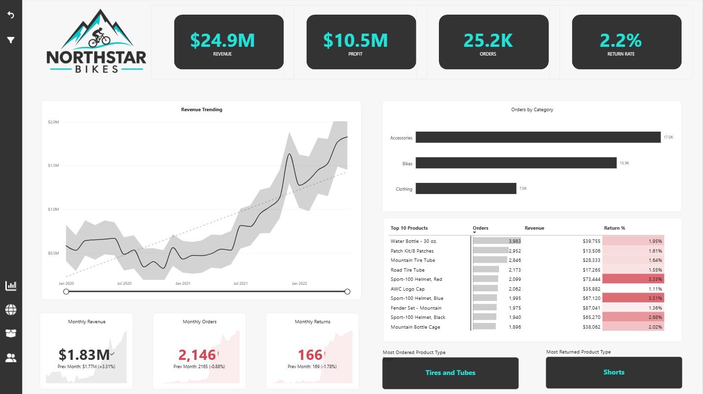
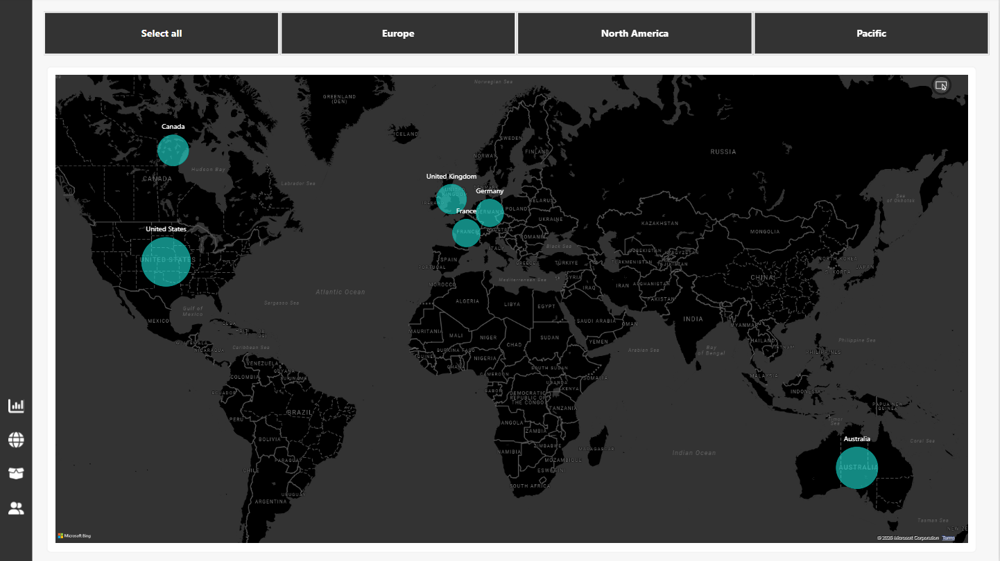
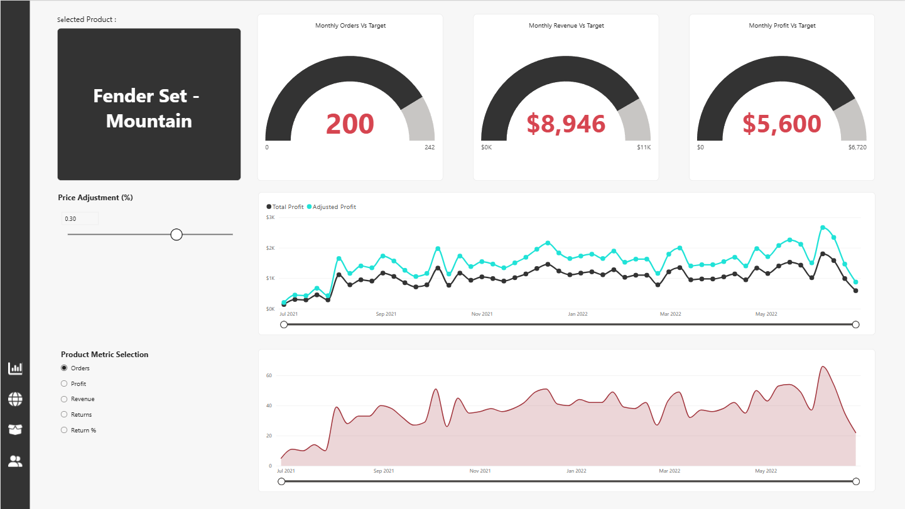
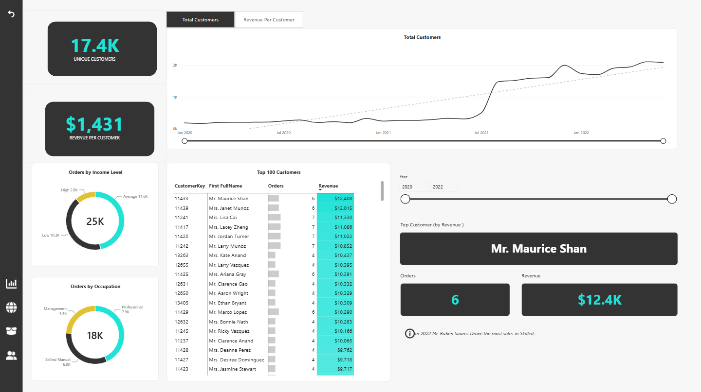

# 🚴 Northstar Bikes | Sales & Customer Analytics

### End-to-End Business Intelligence & Analytics Solution Using Power BI

An end-to-end Power BI analytics solution designed to transform sales, customer, product, regional, and returns data into actionable business insights. This project combines data modeling, advanced DAX, interactive visualizations, time intelligence, target analysis, and dynamic pricing scenarios to support strategic decision-making.

---

## 🎬 Project Deliverables

| Resource | Description |
|---|---|
| 🎥 **[Watch Project Walkthrough](YOUR_YOUTUBE_UNLISTED_VIDEO_LINK)** | Video walkthrough of the Power BI solution, dashboards, analytical features, and key findings |
| 📊 **[Executive Dashboard](./dashboard/screenshots/01-executive-dashboard.png)** | Business performance overview |
| 🌎 **[Regional Analysis](./dashboard/screenshots/02-regional-analysis.png)** | Geographic sales performance |
| 🚲 **[Product Analysis](./dashboard/screenshots/03-product-analysis.png)** | Product performance, targets, and price simulation |
| 👥 **[Customer Analytics](./dashboard/screenshots/04-customer-analytics.png)** | Customer behavior, segmentation, and value |
| 🧩 **[Data Model](./dashboard/screenshots/05-data-model-%20star-snowflake-%20schema.PNG)** | Data model and table relationships |
| 📄 **[Analytics Report (PDF)](./powerbi%20report/Northstar-Bikes-Analytics-Report.pdf)** | Downloadable report containing the analytical solution |
| 🗂️ **[Data Source Files – Overview](./data/)** | Screenshots of the source datasets used in the case study |

---

## 🎯 Business Problem

Northstar Bikes a global manufacturer of cycling equipment and accessories, needed a centralized Business Intelligence solution to gain visibility into business performance across sales, products, regions, and customers.

Management lacked an interactive analytical view to monitor key performance indicators, evaluate regional performance, understand product-level trends, and identify high-value customer segments. 

The objective was to transform raw transactional data into a structured, data-driven reporting solution that enables performance monitoring, comparative analysis, and more informed business decisions.

The project focused on four strategic analytical priorities:

- **Performance Monitoring:** Track critical KPIs across sales, revenue, profitability, and returns to evaluate overall business health.
- **Regional Performance Analysis:** Compare sales performance across geographic markets to identify regional trends, differences, and growth opportunities.
- **Product Performance Analysis:** Analyze product-level sales, profitability, order trends, target attainment, and return behavior to understand product performance and areas for improvement.
- **Customer Value Analysis:** Identify high-value customers and analyze customer purchasing behavior, profiles, and segments to support customer-focused business strategies.

The goal was to build an interactive Power BI solution that transforms raw data into actionable business intelligence through KPI reporting, trend analysis, drill-down capabilities, and dynamic visual exploration.
---

## 🎯 Project Objectives

The solution was designed to address the following business questions:

- How are revenue, profit, and orders trending over time?
- Which product categories and products drive order volume?
- Which geographic regions and countries contribute to sales?
- Which products are meeting their revenue, profit, and order targets?
- How would price adjustments affect product revenue and profitability?
- Which customer segments contribute the most value?
- Who are the highest-value customers?
- How are product returns impacting performance?
- How can business performance be monitored through dynamic KPIs?

---

## 🖥️ Dashboard Showcase

### 1. Executive Dashboard

[🔍 View Full-Resolution Executive Dashboard](./dashboard/screenshots/01-executive-dashboard.png)



Provides a consolidated view of business performance through revenue, profit, orders, and return rate KPIs, supported by revenue trends, category performance, product rankings, and monthly comparisons.

**Key features**
- Executive KPI cards
- Revenue trend analysis with forecasting/trend visualization
- Category-level order analysis
- Top 10 product performance
- Revenue, order, and return month-over-month comparisons
- Product type insights for orders and returns

---

### 2. Regional Analysis

[🔍 View Full-Resolution Regional Dashboard](./dashboard/screenshots/02-regional-analysis.png)



Analyzes sales geography across major markets and regions to provide a view of the business's international footprint.

**Key features**
- Interactive geographic sales map
- Regional navigation
- Europe, North America, and Pacific market analysis
- Country-level geographic exploration
- Interactive region filtering

---

### 3. Product Analysis

[🔍 View Full-Resolution Product Dashboard](./dashboard/screenshots/03-product-analysis.png)



An interactive product-level analytical workspace designed to evaluate performance, monitor targets, and simulate pricing changes.

**Key features**
- Product selection
- Monthly Orders vs Target
- Monthly Revenue vs Target
- Monthly Profit vs Target
- Actual Profit vs Adjusted Profit
- What-if Price Adjustment parameter
- Dynamic product metric selection:
  - Orders
  - Profit
  - Revenue
  - Returns
  - Return %

---

### 4. Customer Analytics

[🔍 View Full-Resolution Customer Dashboard](./dashboard/screenshots/04-customer-analytics.png)



Explores customer acquisition trends, purchasing behavior, revenue contribution, and high-value customers.

**Key features**
- Unique customer KPI
- Revenue per customer KPI
- Customer trend analysis
- Income-level segmentation
- Occupational segmentation
- Top 100 customer ranking
- Customer revenue and order analysis
- Year-based filtering
- Dynamic switching between Total Customers and Revenue per Customer

---

## 💡 Key Business Insights

### Sales & Product Performance

- Accessories contribute the highest order volume among the three product categories.
- Bikes contribute substantial order volume, while Clothing represents a smaller share.
- The Water Bottle – 30 oz. ranks among the highest ordered products.
- Product-level performance varies across orders, revenue, and return percentages.

### Regional Performance

- Sales span multiple international markets across North America, Europe, and the Pacific.
- Regional filtering enables comparison of geographic performance and exploration of individual markets.

### Customer Performance

- The business serves approximately **17.4K unique customers**.
- Revenue per customer is approximately **$1,431**.
- Customer purchasing patterns differ across income levels and occupations.
- The top customer segment and individual customers can be explored through interactive rankings.

### Profitability & Pricing

- Product performance can be evaluated against revenue, profit, and order targets.
- Price adjustments can be simulated to explore their effect on adjusted revenue and profit.
- Actual and adjusted profitability can be compared across monthly trends.

---

## 🎯 Strategic Recommendations

### 1. Prioritize High-Demand Products

Use order volume and product revenue rankings to identify products with sustained demand and evaluate opportunities to improve inventory planning.

### 2. Optimize Regional Strategies

Compare performance across regions and countries to identify strong markets and investigate underperforming geographies.

### 3. Evaluate Product Pricing Strategically

Use price simulation to evaluate potential pricing adjustments while monitoring the impact on revenue and profit.

### 4. Improve Customer Value

Identify high-value customers and understand how income levels and occupations influence purchasing behavior to support customer retention initiatives.

### 5. Monitor Returns Alongside Sales

Evaluate return quantities and return rates alongside revenue and orders to ensure growth is not masking product-quality or customer-experience issues.

### 6. Use Target-Based Performance Monitoring

Track actual performance against revenue, profit, and order targets to identify gaps and support timely business decisions.

---

## ⚙️ Technical Implementation

### Data Preparation & Transformation

- Data ingestion and preparation using Power BI
- Data transformation and shaping using Power Query
- Structured lookup tables for analytical dimensions
- Calendar table preparation for time-based analysis
- Data organization for reporting and analysis

### Data Modeling

- Relational data model connecting sales and returns to lookup dimensions
- Customer, product, territory, category, subcategory, and calendar dimensions
- Fact and lookup table structure
- Relationship management and filter propagation
- Dedicated measure table for centralized DAX management

### DAX & Measure Development

Created a reusable measure library covering:

| Measure Category | Examples |
|---|---|
| Revenue & Profit | Total Revenue, Total Profit, Total Cost |
| Sales | Total Orders, Quantity Sold, Bulk Orders, Weekend Orders |
| Customer Metrics | Total Customers, Average Revenue per Customer |
| Returns | Total Returns, Quantity Returned, Return Rate, Bike Return Rate |
| Time Intelligence | YTD Revenue, Previous Month Revenue, Previous Month Profit |
| Rolling Metrics | 10-Day Rolling Revenue, 90-Day Rolling Profit |
| Targets | Target Revenue, Profit Target, Order Target |
| Variance Analysis | Revenue Target Gap, Profit Target Gap, Order Target Gap |
| Pricing Simulation | Adjusted Price, Adjusted Revenue, Adjusted Profit |

---

## 🚀 Advanced Power BI Capabilities

| Capability | Implementation |
|---|---|
| Dynamic Metric Selection | Switch between product and customer metrics |
| What-If Analysis | Interactive price adjustment parameter |
| Time Intelligence | YTD, previous-period, and rolling calculations |
| Target Analysis | Actual vs revenue, profit, and order targets |
| Variance Analysis | Calculate target gaps |
| KPI Reporting | Revenue, profit, orders, return rate, customer KPIs |
| Customer Segmentation | Analyze customers by income and occupation |
| Geographic Analysis | Interactive regional and country-level exploration |
| Trend Analysis | Time-based sales and customer trends |
| Interactive Filtering | Slicers, product selections, year selection, regional filters |
| Data Modeling | Connected fact and lookup tables |
| DAX Measure Library | Centralized and reusable business calculations |

---

## 🧩 Data Model

[🔍 View Data Model Screenshot](./dashboard/screenshots/05-data-model-%20star-snowflake-%20schema.PNG)


The data model integrates sales and returns with customer, product, territory, calendar, category, and subcategory dimensions.

**Core tables include:**

- Sales Data
- Returns Data
- Customer Lookup
- Product Lookup
- Product Categories Lookup
- Product Subcategories Lookup
- Territory Lookup
- Calendar Lookup
- Measure Table
- Product Metric Selection
- Customer Metric Selection
- Price Adjustment Parameter

The model supports cross-dimensional analysis of transactions, customers, products, geography, time, and returns.

---

## 📂 Dataset Overview

The case study uses sales, returns, product, customer, territory, and date-related data sources.

The repository provides visual references to the source files rather than distributing the underlying datasets.

📁 **[View Data Source Screenshots](./data/)**

---

## 🛠️ Tech Stack

| Technology | Application |
|---|---|
| **Power BI** | Dashboard development, data modeling, analytics, reporting |
| **DAX** | KPI measures, business logic, time intelligence, target calculations |
| **Power Query** | Data transformation and preparation |
| **Data Modeling** | Relational schema, lookup dimensions, relationship design |
| **Data Visualization** | Interactive charts, KPI cards, maps, trends |
| **Business Intelligence** | Performance monitoring, insights, recommendations |

---

## 📁 Repository Structure

```text
northstar-bikes-sales-customer-analytics-power-bi/
│
├── assets/
│   └── logo/
│       └── Northstar Bikes Logo.png
│
├── dashboard/
│   ├── screenshots/
│   │   ├── 01-executive-dashboard.png
│   │   ├── 02-regional-analysis.png
│   │   ├── 03-product-analysis.png
│   │   ├── 04-customer-analytics.png
│   │   └── 05-data-model-star-snowflake-schema.PNG
│   │
│   └── video/
│       └── Walkthrough (hosted externally)
│
├── data/
│   ├── 1.data-source-files.PNG
│   └── 2.sales-data-by-year.PNG
│
├── powerbi report/
│   └── Northstar-Bikes-Analytics-Report.pdf
│
└── README.md
```

---


## 📌 Project Context

This project was developed as part of a guided business analytics case study. The focus of the implementation was to apply Power BI skills to build an end-to-end analytical solution, including data preparation, relational modeling, DAX development, interactive reporting, and business insight generation.

The project demonstrates the practical application of Business Intelligence techniques to business performance analysis.

---

## 👤 About

**Data Analyst | SQL • Python • Power BI • Tableau • Excel**

Focused on transforming data into meaningful insights, building analytical solutions, and supporting business decision-making through data storytelling, KPI development, and business intelligence.

**Core Skills Demonstrated**

`Power BI` `DAX` `Power Query` `Data Modeling` `Business Intelligence` `KPI Reporting` `Time Intelligence` `Data Visualization` `Customer Analytics` `Sales Analytics` `What-If Analysis` `Business Insights`
